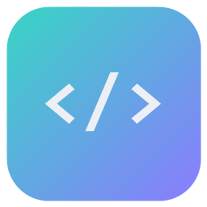
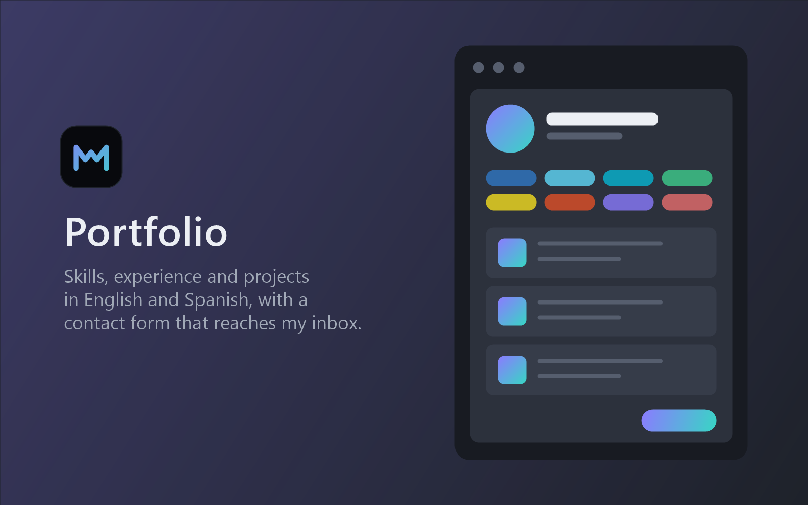

<div align="center">



# Portfolio for developers

**A fast, responsive single-page portfolio, in English and Spanish, with a contact form that lands straight in your inbox**

[](https://portfolio.moilolon.com)




</div>

---

## ✨ What this is

| | Section | What it shows |
|---|---|---|
| 🙋 | **Information** | Avatar, name, role, location and quick links: email, CV, GitHub, LinkedIn |
| 🧰 | **Technologies** | Skills by category, split into daily use and past experience |
| 💼 | **Experience** | Work history with expandable entries |
| 🚀 | **Projects** | Project cards with their stack and links, filterable by technology |
| 🎓 | **Training** | Education, courses and languages |
| 💬 | **About me** | Who I am and how I work |
| 📄 | **CV** | A PDF in English and Spanish, generated from the same content |
| ✉️ | **Contact** | A form that sends me an email I can reply to |

---

## 🧭 How it works

- **The content is data.** Every section reads JSON files written in both languages side
  by side, and the CV is generated from the same files on every build.
- **English and Spanish.** Every page lives under `/en` and `/es`. The choice is kept in a
  cookie shared with the other moilolon.com sites; without it, the browser's language decides.
- **Light and dark.** It follows the system and remembers a manual choice, with no flash on load.
- **The contact form** is protected by invisible reCAPTCHA v3, a honeypot and a rate
  limit. Each message is saved in Supabase and notified by email with Resend; the ones
  that fail are retried daily.
- **Published on Vercel** from `main`, with Analytics and Speed Insights. GitHub Actions
  runs lint, tests and build on every push.

---

## 🚀 Getting started

Node.js 26 and accounts for Supabase, Resend and Google reCAPTCHA. The variables go in
`.env.local`; [`CLAUDE.md`](CLAUDE.md) lists them.

```bash
npm install
npm run dev
```

---

<div align="center">
<sub><a href="https://moilolon.com">moilolon.com</a> · <a href="https://github.com/moilolon">@moilolon</a></sub>
</div>
