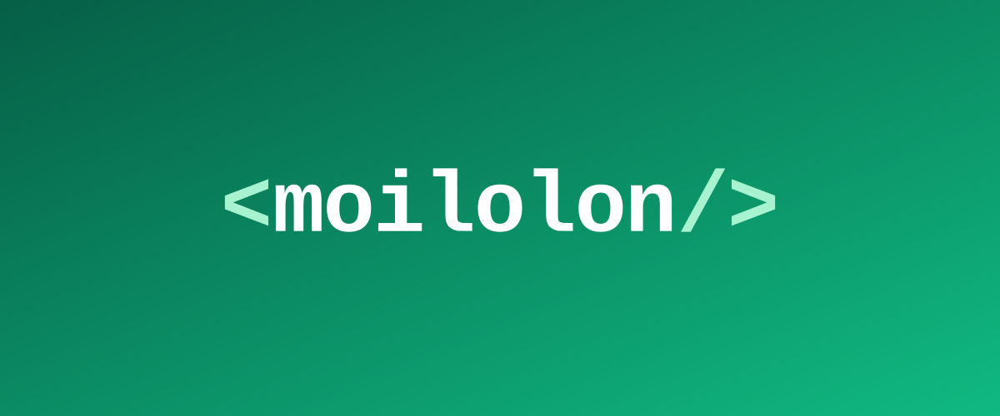
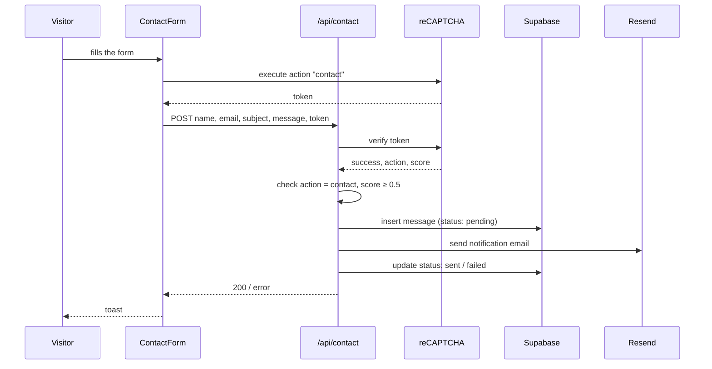

<div align="center">

# 👨🏻‍💻 Portfolio for developers

A fast, responsive single-page portfolio to present your skills, experience and projects,
with a contact form that lands straight in your inbox.

[**🌐 Live site**](https://portfolio.moilolon.com) · [Report a bug](https://github.com/moilolon/portfolio/issues/new) · [Request a feature](https://github.com/moilolon/portfolio/issues/new)

<br />


<br />

<a href="https://portfolio.moilolon.com">
  
</a>

</div>

---

## ✨ Features

| | Section | What it shows |
|---|---|---|
| 🙋 | **Information** | Avatar, name, role, location and quick links: email, CV (PDF), GitHub, LinkedIn |
| 🧰 | **Technologies** | Skills by category, with brand icons, split into daily use and past experience |
| 💼 | **Experience** | Work history with expandable entries: summary, key points and technologies |
| 🚀 | **Projects** | Project cards with key points, tech stack and GitHub / live links, filterable by technology |
| 🎓 | **Training** | Education and certifications |
| 💬 | **About me** | Who I am and how I work |
| ✉️ | **Contact** | Modal form protected by invisible reCAPTCHA v3, with toast feedback and email notification |

**Under the hood:** server components by default, light/dark theme that follows the system
preference with a manual toggle (remembered, no flash on load), smooth-scrolling navigation, mobile-first layout, SEO metadata, and
[Vercel Analytics](https://vercel.com/analytics) + [Speed Insights](https://vercel.com/docs/speed-insights)
for real-user Core Web Vitals.

## 🛠 Tech stack

| Layer | Technology |
|---|---|
| Framework | [Next.js 15](https://nextjs.org) — App Router, Turbopack in dev |
| UI | [React 19](https://react.dev), [Tailwind CSS 4](https://tailwindcss.com), [Geist](https://vercel.com/font) |
| Language | [TypeScript](https://www.typescriptlang.org) (strict) |
| Database | [Supabase](https://supabase.com) (Postgres + Row Level Security) |
| Email | [Resend](https://resend.com) |
| Anti-spam | [Google reCAPTCHA v3](https://developers.google.com/recaptcha/docs/v3) — invisible, score-based |
| Hosting & monitoring | [Vercel](https://vercel.com), Vercel Analytics, Speed Insights |
| CI | GitHub Actions — lint on every branch push |

## 📨 How the contact form works



## 🚀 Getting started

**Prerequisites:** Node.js LTS, npm, and accounts for Supabase, Resend and Google reCAPTCHA
(a **v3** key, managed from a Google Cloud project, with `localhost` among its domains to test locally).

```bash
git clone https://github.com/moilolon/portfolio.git
cd portfolio
npm install
```

Create `.env.local` at the root:

```bash
# Public — shipped to the browser
NEXT_PUBLIC_SUPABASE_URL=
NEXT_PUBLIC_SUPABASE_ANON_KEY=
NEXT_PUBLIC_RECAPTCHA_SITE_KEY=

# Server only
RESEND_API_KEY=
RECAPTCHA_SECRET_KEY=
NOTIFICATION_EMAIL=
```

Apply the migrations in [`supabase/migrations/`](supabase/migrations) to your project
(`supabase db push`, or paste them in the SQL editor), then:

```bash
npm run dev
```

Open [http://localhost:3000](http://localhost:3000).

### Scripts

| Command | Does |
|---|---|
| `npm run dev` | Dev server with Turbopack |
| `npm run build` | Production build (also the type check) |
| `npm run start` | Serve the production build |
| `npm run lint` | ESLint (`next/core-web-vitals` + `next/typescript` + ESLint Stylistic); `-- --fix` formats |

## 🧩 Make it yours

The content is data, not markup — edit these files and the sections follow:

| To change | Edit |
|---|---|
| Name, role, links, avatar, CV | [`src/lib/constants/information.tsx`](src/lib/constants/information.tsx), `public/avatar.jpg`, `public/cv/` |
| Technologies, colors and daily / past usage | [`src/lib/constants/technologies.tsx`](src/lib/constants/technologies.tsx) |
| Jobs (summary, key points, technologies) | [`src/lib/constants/experience.tsx`](src/lib/constants/experience.tsx) |
| Projects (newest first) | [`src/lib/constants/projects.tsx`](src/lib/constants/projects.tsx), images in `public/projects/` |
| Training, About me | [`Training.tsx`](src/components/sections/Training.tsx), [`AboutMe.tsx`](src/components/sections/AboutMe.tsx) (inline for now) |
| Page title and SEO | [`src/app/layout.tsx`](src/app/layout.tsx) |
| Colors, light/dark theme and animations | [`src/app/globals.css`](src/app/globals.css) |

Technologies in jobs and projects are referenced by name and must exist in `technologies.tsx`,
which also sets their chip color. The ones marked `usage: 'daily'` become the quick filters of the Projects section.

## 🏗 Project structure

```text
src/
├── app/
│   ├── api/contact/route.ts   # contact endpoint
│   ├── layout.tsx             # fonts, metadata, analytics
│   ├── page.tsx               # composes every section
│   └── globals.css            # Tailwind, theme variables, animations
├── components/
│   ├── sections/              # Information, Technologies, Experience, Projects, Training, AboutMe
│   ├── layouts/               # Navbar
│   ├── forms/ · modals/ · ui/ # ContactForm, ContactModal, Modal, Toast, ThemeToggle
│   └── icons/                 # SVG icons, grouped by section
├── lib/
│   ├── constants/             # the site's content
│   ├── supabase/ · resend/    # service clients
│   ├── recaptcha.ts           # reCAPTCHA v3 loader
│   ├── theme.ts               # theme init script (runs before paint)
│   └── colors.ts              # chip color helper
└── types/                     # content types
supabase/migrations/           # database schema
```

## 🗺 Roadmap

- [x] All portfolio sections, responsive and animated
- [x] Contact form with reCAPTCHA, Supabase and Resend
- [x] Vercel Analytics and Speed Insights
- [x] Manual light/dark toggle
- [x] Filter projects by technology
- [ ] Blog section

## 🤖 Built with Claude Code and Zed

Developed with [Claude Code](https://docs.claude.com/en/docs/claude-code) in [Zed](https://zed.dev):

- [`CLAUDE.md`](CLAUDE.md) — project memory: stack, architecture, commands and conventions.
- [`.claude/rules/`](.claude/rules) — rules read on demand (Next.js, Supabase, git, files, docs).
- [`.claude/settings.json`](.claude/settings.json) — shared permissions; `.env*` files are never readable.
- [`.zed/`](.zed) — editor settings, tasks and debugger, see [`.zed/README.md`](.zed/README.md).

## 🫂 Contributors

<a href="https://github.com/moilolon/portfolio/graphs/contributors">
  
</a>

<div align="center">
<br />

Made with ☕ in A Coruña · [portfolio.moilolon.com](https://portfolio.moilolon.com)

</div>
